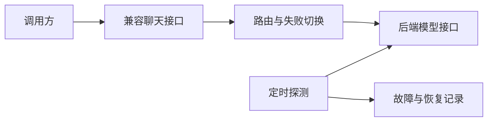

# 模型接口路由与可用性监测

[返回项目索引](https://github.com/18538205298/project-portfolio)

## 项目概览

由接口转发和状态监测两个工具组成。前者提供兼容聊天接口及失败切换，后者通过定时探测记录故障与恢复情况。

**技术栈**：Node.js 原生 HTTP/HTTPS、JavaScript。

## 功能组成

| 工具 | 功能 |
| --- | --- |
| 接口路由 | 聊天请求转发、模型或后端失败切换、调用统计 |
| 状态监测 | 定时探测、故障区间记录、恢复判断 |

## 结构示意

## 技术要点

- 接口转发如何处理流式响应与超时。
- 失败切换的触发条件如何设定。
- 调用统计如何与请求处理分开。
- 定时探测如何定义异常和恢复。
- 日志和监测结果如何控制可见范围。

## 展示边界

展示内容聚焦机制与模块划分。供应商信息、服务地址、访问凭证、调用记录和运行配置保留在个人环境中。可用性与延迟效果以实际监测记录为依据。

## 关键代码

- `samples/tier-routing.js`：原模型路由的档位选择片段。
- `samples/system-metrics.js`：原监测服务的内存、网络和磁盘读取片段。

这些文件保留原项目中的核心逻辑，供阅读和交流。完整应用还包含其余模块、依赖与运行配置。
