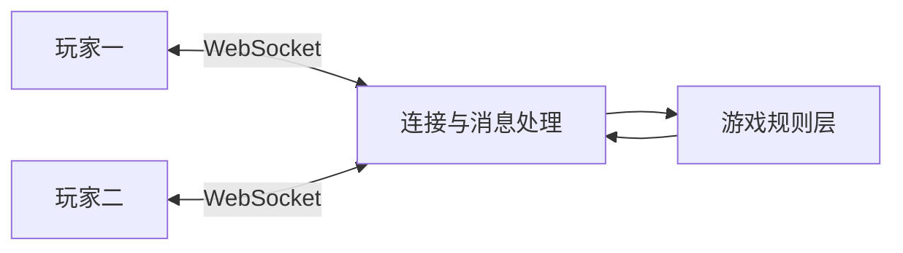

# 双人联机游戏练习

[返回项目索引](https://github.com/18538205298/project-portfolio)

## 项目概览

两种双人互动游戏：宠物卡牌对战与猜拳战棋。适合交流房间通信、游戏规则组织和实时状态同步。

**技术栈**：Node.js、Express、WebSocket、JavaScript。

## 组织方式

- **游戏规则层**：组织回合与规则逻辑。
- **网络连接层**：处理客户端连接和消息传递。
- **双人交互**：通过 WebSocket 传递玩家操作与游戏状态。

## 结构示意

## 技术要点

- 规则逻辑如何与网络连接分开。
- 操作消息如何与回合状态对应。
- 服务端如何判断操作是否有效。
- 重复消息、断线与状态同步如何处理。

## 展示范围

这里展示交互和工程组织方式。美术、音效与其他素材按各自来源确认授权；具体玩法和断线处理能力以实际运行演示为准。

## 关键代码

- `samples/card-game.js`：来自原项目 `game/game.js`。
- `samples/strategy-game.js`：来自原项目 `caiquan/game.js`。

这些文件保留原项目中的核心逻辑，供阅读和交流。完整应用还包含其余模块、依赖与运行配置。
